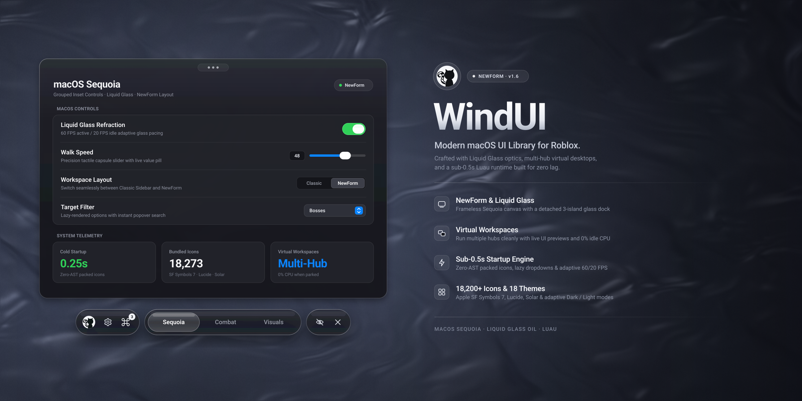

<p align="center">
  
</p>

# macOS WindUI — Sequoia & Liquid Glass Edition

> **Bilingual Documentation / Tài liệu Song ngữ:** [🇺🇸 English](#-english-tutorial--usage-guide) | [🇻🇳 Tiếng Việt](#-hướng-dẫn-sử-dụng-chi-tiết-tiếng-việt)

A modern **macOS Sequoia / Apple Liquid Glass** UI library for Roblox scripts. Features **18,273 Zero-AST packed offline icons** (**Apple SF Symbols 7**, **Lucide**, **Solar**, **Craft**, **Geist**, **Gravity**), **Classic Sidebar** & **NewForm (System Settings + 3-Island Liquid Glass Navigate Bar)** layouts, **Multi-Hub Virtual Desktop / Workspace Switcher** (`⌘` 1-tap switching with live Display UI previews & 0% idle CPU), **Sub-0.5s startup engine** (lazy Dropdowns + adaptive 60/20 FPS GPU pacing), **macOS Notification Center & Dynamic Island**, **2-Zone Mini Dock**, **Curved Edge Pull-Handles**, **3D/UI Eyedropper Colorpicker**, **Keybind Menu HUD**, and automatic **Mobile & PC scaling**.

---

## ⚡ Quick Loadstrings / Chạy Nhanh

### 1. Run Full Demo (`example.luau`) / Chạy bản Demo đầy đủ
```lua
loadstring(game:HttpGet("https://raw.githubusercontent.com/darkfantasyisreal/Macos-Windui/refs/heads/main/example.luau"))()
```

### 2. Import Library into Your Script (`main.luau`) / Nạp thư viện vào Script của bạn
```lua
local WindUI = loadstring(game:HttpGet("https://raw.githubusercontent.com/darkfantasyisreal/Macos-Windui/refs/heads/main/main.luau"))()
```

### 3. Offline / Executor Workspace (`readfile`)
```lua
-- If main.luau / example.luau are saved in your executor's Workspace folder:
local WindUI = loadstring(readfile("main.luau"))()
```

---

# 🇺🇸 English Tutorial & Usage Guide

## Step 1: Load the Library & Create a Window

Start by loading `WindUI` and calling `WindUI:CreateWindow(config)`. By default, it uses the **macOS Sequoia Dark (`"MacOS"`)** theme and automatically scales to fit mobile and desktop screens.

```lua
local WindUI = loadstring(game:HttpGet("https://raw.githubusercontent.com/darkfantasyisreal/Macos-Windui/refs/heads/main/main.luau"))()

local Window = WindUI:CreateWindow({
    Title = "My macOS Hub",
    Author = "v1.6.66 • macOS Sequoia",
    Icon = "sfsymbols:appleLogo", -- Supports "sfsymbols:<name>", Lucide icon names, or "rbxassetid://..."
    Folder = "MyMacOSHub",        -- Folder name in Workspace for saving configs & colors
    Theme = "MacOS",              -- "MacOS" (Dark) or "MacOSLight" (Light)
    Size = UDim2.fromOffset(600, 420),
    Transparent = true,           -- Translucent macOS vibrancy background
    AutoScale = true,             -- Automatically scales UI on mobile phones & tablets
    LayoutMode = "Classic",       -- "Classic" (Sidebar) or "NewForm" (Sidebar-less + Bottom Navigate Bar)
    SidebarMode = "Full",         -- "Full" (Icon + Title) or "IconOnly" (Compact macOS icon rail)
    ToggleKey = Enum.KeyCode.RightShift,

    -- Optional macOS Boot Intro Animation (set Intro = false to skip)
    Intro = {
        Enabled = true,
        Title = "My macOS Hub",
        Subtitle = "Liquid Glass Interface",
        Icon = "sfsymbols:sparkles",
    },

    -- Floating macOS 2-Zone Mini Dock shown when the window is minimized
    OpenButton = {
        Title = "My Hub",
        Enabled = true,
        OnlyMobile = false,
        SearchButton = true,      -- Adds a quick Spotlight Search button on the Mini Dock
    },
})

-- Optional: Add a version badge to the top titlebar
Window:Tag({
    Title = "SEQUOIA",
    Color = Color3.fromHex("#0A84FF"),
})
```

---

## Step 2: Create Sidebar Sections, Tabs & Content Groups

Organize your tabs inside sidebar sections (or add tabs directly to `Window`). Inside a tab, use `Tab:Section(...)` to group related controls.

```lua
-- 1. Create a Sidebar Category
local MainGroup = Window:Section({
    Title = "Workspace",
    Opened = true,
})

-- 2. Create a Tab inside the Sidebar Category
local MainTab = MainGroup:Tab({
    Title = "Combat & Farm",
    Icon = "sfsymbols:boltFill",
})

-- Optional: Add a pill badge to the tab in the sidebar
MainTab:SetBadge("HOT")

-- 3. Create a Content Section inside the Tab
-- (In "NewForm" mode, this automatically becomes a macOS System Settings Grouped Inset Card!)
local CombatSection = MainTab:Section({
    Title = "Auto Farm Controls",
    Desc = "Configure target priority, range, and automation speed",
    Opened = true,
})
```

---

## Step 3: Add Interactive Controls (Elements)

All elements support `Flag = "UniqueName"` so their values can be read anywhere via `WindUI.Flags["UniqueName"]` and saved automatically by `ConfigManager`.

### 1. Toggle (Switch / Checkbox) + Keybind + Floating Pill Button
```lua
local AutoFarm = CombatSection:Toggle({
    Title = "Enable Auto Farm",
    Desc = "Automatically farm nearest targets",
    Type = "Toggle", -- "Toggle" (Liquid Glass switch) or "Checkbox"
    Value = false,
    Flag = "AutoFarmEnabled",
    Callback = function(state)
        print("Auto Farm is now:", state)
    end,
})

-- Attach a hotkey directly to this Toggle (shows in the Keybind Menu HUD)
AutoFarm:BindKey({
    Value = "F",
    Mode = "Toggle", -- "Toggle" | "Hold" | "Always"
})

-- Pin a draggable floating quick-toggle pill on screen synced with this Toggle
AutoFarm:PinButton({
    Title = "Auto Farm",
    Icon = "zap",
})
```

### 2. Segmented Control (`NSSegmentedControl`)
```lua
local ModeSeg = CombatSection:Segmented({
    Title = "Attack Mode",
    Values = { "Fast", "Safe", "Stealth" },
    Value = "Fast",
    Flag = "AttackMode",
    Callback = function(selected)
        print("Selected mode:", selected)
    end,
})
```

### 3. Slider & RangeSlider
```lua
-- Single value Slider
CombatSection:Slider({
    Title = "WalkSpeed",
    Desc = "Character movement speed",
    Step = 1,
    Value = { Min = 16, Max = 200, Default = 48 },
    Flag = "WalkSpeed",
    Callback = function(value)
        print("Speed:", value)
    end,
})

-- Dual-thumb Min/Max RangeSlider
CombatSection:RangeSlider({
    Title = "Engagement Distance",
    Step = 1,
    Value = { Min = 0, Max = 150, Default = { 20, 80 } },
    Flag = "DistanceRange",
    Callback = function(range)
        print("Min:", range[1], "Max:", range[2])
    end,
})
```

### 4. Dropdown (Single, Multi-Select, or Searchable)
```lua
CombatSection:Dropdown({
    Title = "Target Filter",
    Desc = "Choose which entities to attack",
    Values = {
        { Title = "Bosses", Desc = "High reward targets" },
        { Title = "Mobs", Desc = "Regular enemies" },
        { Title = "Chests", Desc = "Loot containers" },
    },
    Value = "Bosses",
    Multi = false,            -- Set true to select multiple items
    SearchBarEnabled = true,  -- Adds a search filter inside the dropdown
    Flag = "TargetFilter",
    Callback = function(selected)
        print("Target:", selected)
    end,
})
```

### 5. Input (Text, Password, Numeric Stepper, or Textarea)
```lua
-- Standard text or password input
CombatSection:Input({
    Title = "Webhook URL",
    Placeholder = "https://discord.com/api/webhooks/...",
    Masked = false,      -- Set true for password eye-toggle masking
    ClearButton = true,  -- Shows (x) clear button when non-empty
    Callback = function(text)
        print("Webhook:", text)
    end,
})

-- Numeric Stepper with [-] and [+] buttons
CombatSection:Input({
    Title = "Refresh Delay (s)",
    Numeric = true,
    Stepper = true,
    Min = 1,
    Max = 60,
    Step = 1,
    Value = 5,
    Callback = function(num)
        print("Delay:", num)
    end,
})
```

### 6. Button (with Double-Tap Confirmation)
```lua
CombatSection:Button({
    Title = "Reset All Stats",
    Desc = "Requires confirmation before running",
    Icon = "sfsymbols:arrowCounterclockwise",
    Confirm = true,
    ConfirmTitle = "Tap again to confirm reset",
    Callback = function()
        print("Stats reset!")
    end,
})
```

### 7. Colorpicker (with Live 3D/UI Eyedropper & Saved Colors)
```lua
CombatSection:Colorpicker({
    Title = "ESP Highlight Color",
    Desc = "Includes Map/RGB tabs, opacity, and screen eyedropper",
    Default = Color3.fromHex("#0A84FF"),
    Transparency = 0.15, -- Omit or set nil to disable opacity slider
    Flag = "ESPColor",
    Callback = function(color, transparency)
        print("Color:", color, "Transparency:", transparency)
    end,
})
```

---

## Step 4: Telemetry, Logs & Layout Containers

```lua
-- StatCard (2- or 3-column metric grid)
local Telemetry = CombatSection:StatCard({
    Title = "Live Telemetry",
    Columns = 2,
    Items = {
        { Title = "FPS", Value = "120", Color = "#30D158" },
        { Title = "Ping", Value = "24 ms", Color = "#0A84FF" },
    },
})
-- Update a single metric dynamically:
Telemetry:SetItem(1, { Title = "FPS", Value = "144", Color = "#30D158" })

-- ProgressBar
local Progress = CombatSection:ProgressBar({
    Title = "Quest Completion",
    Value = { Min = 0, Max = 100, Default = 45 },
})
Progress:Set(75)

-- Live Console with Copy Logs & Clear buttons
local LogConsole = CombatSection:Console({
    Title = "Execution Console",
    Height = 140,
    ShowControls = true,
})
LogConsole:Info("Scanner initialized")
LogConsole:Success("Found 3 targets nearby")
LogConsole:Warn("Low stamina")
```

---

## Step 5: Notifications (macOS Banner & Dynamic Island)

Switch between **macOS Notification Center Banners** and **Apple Dynamic Island** at any time:

```lua
-- Set global style: "MacOS" or "DynamicIsland"
WindUI:SetNotificationStyle("MacOS")
WindUI:SetNotificationPosition("TopRight") -- TopRight, TopCenter, TopLeft, BottomRight, BottomCenter, BottomLeft

-- Send a Notification
local Notif = WindUI:Notify({
    Title = "Auto Farm Active",
    Subtitle = "Combat System",
    Content = "Farming level 50 area...",
    Icon = "sfsymbols:boltFill",
    Duration = 5,
    Style = "MacOS", -- Or "DynamicIsland" for this specific notification
})
```

---

## Step 6: Built-in Settings Tab & 60 FPS Liquid Oil Navigate Bar (`NewForm`)

Add a complete **Settings Tab** (Theme switcher, UI Scale slider, Notification Style/Position, Keybind Menu HUD toggle, and Config Save/Load profiles) with a single line, and enable the **60 FPS Liquid Oil Glass Morph Navigate Bar** with its **Apple Liquid Glass sliding active-tab lens** (supports spring-mass jelly morph & press-and-drag scrubbing across tabs):

```lua
-- Automatically creates a full Settings tab:
Window:CreateSettingsTab({
    Title = "Hub Settings",
})

-- Switch between Classic Sidebar and macOS NewForm (Solid macOS Frosted-Glass Navigate Bar):
Window:SetLayoutMode("NewForm")
-- Window:SetLayoutMode("Classic")

-- Optional NavBar customization inside WindUI:CreateWindow({ ... }):
-- NavBarPosition = "Bottom",  -- "Bottom" | "Top" | "Left" | "Right"
-- NavBar = {
--     Position = "Bottom",    -- Dock on any of the 4 screen edges ("Bottom" | "Top" | "Left" | "Right")
--     GlassTransparency = 0,  -- 0 = solid opaque macOS frosted glass (0 .. 0.85)
--     LiquidOil = true,       -- Subtle living frosted-glass sheen
--     OilIntensity = 1,       -- 0.0 .. 1.4 sheen strength
--     LiquidGlassLens = true, -- 60 FPS sliding active-tab glass pill with spring physics
-- }

-- Move Navigate Bar across all 4 edges live at runtime (also in Settings -> Interface):
-- Window:SetNavBarPosition("Left")    -- "Bottom" | "Top" | "Left" | "Right"
-- Window:GetNavBarPosition()

-- Universal Spotlight Search (Ctrl+K / Cmd+K or NavBar Search button):
-- Window:OpenSearch()
-- Window:SearchElements("walk speed")

-- Toggle frosted sheen dynamically at runtime:
-- Window.NavBar:SetLiquidOil(true)

-- Select the first tab when ready:
MainTab:Select()
```

---
---

# 🇻🇳 Hướng Dẫn Sử Dụng Chi Tiết (Tiếng Việt)

## Bước 1: Nạp Thư Viện & Tạo Cửa Sổ (`Window`)

Dùng `loadstring(game:HttpGet(...))()` để nạp `WindUI`, sau đó gọi `WindUI:CreateWindow`. Thư viện mặc định sử dụng giao diện **macOS Sequoia Dark (`"MacOS"`)** và tự động co giãn (`AutoScale = true`) vừa khít màn hình điện thoại lẫn máy tính.

```lua
local WindUI = loadstring(game:HttpGet("https://raw.githubusercontent.com/darkfantasyisreal/Macos-Windui/refs/heads/main/main.luau"))()

local Window = WindUI:CreateWindow({
    Title = "Tên Hub Của Bạn",
    Author = "v1.6.66 • macOS Sequoia",
    Icon = "sfsymbols:appleLogo", -- Dùng icon Apple "sfsymbols:<tên>", Lucide icon hoặc "rbxassetid://..."
    Folder = "MyMacOSHub",        -- Tên thư mục lưu file cấu hình (Config) trong Workspace
    Theme = "MacOS",              -- "MacOS" (Tối) hoặc "MacOSLight" (Sáng)
    Size = UDim2.fromOffset(600, 420),
    Transparent = true,           -- Nền kính mờ chuẩn macOS
    AutoScale = true,             -- Tự động thu phóng chuẩn tỷ lệ trên Mobile
    LayoutMode = "Classic",       -- "Classic" (có Sidebar trái) hoặc "NewForm" (ẩn Sidebar + thanh điều hướng nổi ở đáy)
    SidebarMode = "Full",         -- "Full" (Hiện Icon + Tên) hoặc "IconOnly" (Chỉ hiện cột Icon gọn)
    ToggleKey = Enum.KeyCode.RightShift, -- Phím đóng/mở nhanh UI trên PC

    -- Hiệu ứng Intro khởi động kiểu Apple (đặt Intro = false nếu muốn tắt)
    Intro = {
        Enabled = true,
        Title = "Tên Hub Của Bạn",
        Subtitle = "Giao diện macOS Sequoia",
        Icon = "sfsymbols:sparkles",
    },

    -- Thanh Mini Dock nổi khi thu nhỏ (Minimize) cửa sổ
    OpenButton = {
        Title = "Mở Hub",
        Enabled = true,
        OnlyMobile = false,
        SearchButton = true,      -- Hiện thêm nút kính lúp tìm kiếm nhanh trên Mini Dock
    },
})

-- (Tùy chọn) Gắn nhãn phiên bản lên thanh tiêu đề
Window:Tag({
    Title = "v1.6.66",
    Color = Color3.fromHex("#0A84FF"),
})
```

---

## Bước 2: Tạo Nhóm Sidebar, Tab & Section Nội Dung

- `Window:Section(...)`: Tạo nhóm danh mục ở thanh Sidebar bên trái.
- `MainGroup:Tab(...)` (hoặc `Window:Tab(...)`): Tạo Tab chuyển trang.
- `Tab:Section(...)`: Tạo khung nhóm các chức năng bên trong trang Tab.

```lua
-- 1. Tạo danh mục trên Sidebar
local MainGroup = Window:Section({
    Title = "Chức Năng Chính",
    Opened = true,
})

-- 2. Tạo Tab bên trong danh mục
local MainTab = MainGroup:Tab({
    Title = "Auto Farm",
    Icon = "sfsymbols:boltFill",
})

-- Gắn huy hiệu nhỏ bên cạnh tên Tab:
MainTab:SetBadge("NEW")

-- 3. Tạo Section gom nhóm các nút điều khiển trong Tab
local FarmSection = MainTab:Section({
    Title = "Thiết Lập Tự Động Đánh",
    Desc = "Tùy chỉnh tốc độ, khoảng cách và mục tiêu ưu tiên",
    Opened = true,
})
```

---

## Bước 3: Thêm Các Thành Phần Điều Khiển (`Elements`)

### 1. Công tắc Bật/Tắt (`Toggle`) + Phím tắt (`BindKey`) + Nút nổi (`PinButton`)
```lua
local AutoFarmToggle = FarmSection:Toggle({
    Title = "Bật Auto Farm",
    Desc = "Tự động tìm và đánh mục tiêu gần nhất",
    Type = "Toggle", -- "Toggle" (công tắc trượt Liquid Glass) hoặc "Checkbox" (ô tích)
    Value = false,
    Flag = "AutoFarm",
    Callback = function(state)
        print("Trạng thái Auto Farm:", state)
    end,
})

-- Gắn phím tắt cho Toggle (tự động đồng bộ vào bảng Keybind Menu HUD)
AutoFarmToggle:BindKey({
    Value = "F",
    Mode = "Toggle", -- "Toggle" (Bấm bật/tắt) | "Hold" (Giữ phím) | "Always" (Luôn bật)
})

-- Tạo nút viên thuốc nổi trên màn hình để bật/tắt nhanh khi đóng menu
AutoFarmToggle:PinButton({
    Title = "Auto Farm",
    Icon = "zap",
})
```

### 2. Thanh Chọn Nhanh (`Segmented`)
```lua
FarmSection:Segmented({
    Title = "Kiểu Thông Báo",
    Values = { "MacOS", "DynamicIsland" },
    Value = "MacOS",
    Callback = function(style)
        WindUI:SetNotificationStyle(style)
    end,
})
```

### 3. Thanh Kéo Giá Trị (`Slider` & `RangeSlider`)
```lua
-- Thanh kéo 1 giá trị
FarmSection:Slider({
    Title = "Tốc Độ Chạy (WalkSpeed)",
    Desc = "Điều chỉnh tốc độ nhân vật",
    Step = 1,
    Value = { Min = 16, Max = 200, Default = 50 },
    Flag = "WalkSpeed",
    Callback = function(val)
        print("WalkSpeed:", val)
    end,
})

-- Thanh kéo khoảng giá trị (Từ Min đến Max)
FarmSection:RangeSlider({
    Title = "Khoảng Cách Tấn Công",
    Step = 1,
    Value = { Min = 0, Max = 150, Default = { 15, 75 } },
    Callback = function(range)
        print("Từ:", range[1], "Đến:", range[2])
    end,
})
```

### 4. Danh Sách Thả Xuống (`Dropdown`)
```lua
FarmSection:Dropdown({
    Title = "Chọn Mục Tiêu",
    Desc = "Hỗ trợ mô tả phụ cho từng lựa chọn và thanh tìm kiếm",
    Values = {
        { Title = "Boss", Desc = "Ưu tiên săn Boss trước" },
        { Title = "Quái Thường", Desc = "Farm quái xung quanh" },
        { Title = "Rương", Desc = "Tự động nhặt rương" },
    },
    Value = "Boss",
    Multi = false,           -- Đặt true nếu muốn cho phép chọn nhiều mục cùng lúc
    SearchBarEnabled = true, -- Hiện ô tìm kiếm bên trong danh sách
    Callback = function(selected)
        print("Đã chọn:", selected)
    end,
})
```

### 5. Ô Nhập Liệu (`Input` & `Stepper`)
```lua
-- Ô nhập chữ / link / mật khẩu
FarmSection:Input({
    Title = "Discord Webhook",
    Placeholder = "Nhập link webhook...",
    Masked = false,     -- Đặt true để ẩn ký tự kiểu mật khẩu (có nút con mắt)
    ClearButton = true, -- Hiện nút (x) xóa nhanh nội dung
    Callback = function(text)
        print("Webhook:", text)
    end,
})

-- Ô nhập số kèm nút [-] [+] (Stepper)
FarmSection:Input({
    Title = "Chu Kỳ Lặp (Giây)",
    Numeric = true,
    Stepper = true,
    Min = 1,
    Max = 60,
    Step = 1,
    Value = 5,
    Callback = function(val)
        print("Chu kỳ:", val)
    end,
})
```

### 6. Nút Bấm (`Button`) & Chọn Màu (`Colorpicker`)
```lua
-- Nút bấm có chế độ bấm 2 lần để xác nhận (Confirm)
FarmSection:Button({
    Title = "Reset Nhân Vật",
    Desc = "Chống bấm nhầm bằng xác nhận 2 bước",
    Icon = "sfsymbols:arrowCounterclockwise",
    Confirm = true,
    ConfirmTitle = "Bấm lần nữa để xác nhận!",
    Callback = function()
        print("Đã reset!")
    end,
})

-- Bảng chọn màu macOS (có ống hút màu Eyedropper trên màn hình & lưu 9 ô màu)
FarmSection:Colorpicker({
    Title = "Màu ESP",
    Default = Color3.fromHex("#0A84FF"),
    Transparency = 0,
    Callback = function(color, transparency)
        print("Màu:", color, "Độ trong suốt:", transparency)
    end,
})
```

---

## Bước 4: Bảng Thống Kê (`StatCard`), Tiến Độ (`ProgressBar`) & Nhật Ký (`Console`)

```lua
-- Thẻ hiển thị chỉ số trực quan
local Stats = FarmSection:StatCard({
    Title = "Thống Kê Phiên Chơi",
    Columns = 2,
    Items = {
        { Title = "Số Quái Hạ", Value = "128", Color = "#30D158" },
        { Title = "Vàng Nhặt Được", Value = "15,400", Color = "#FF9F0A" },
    },
})

-- Thanh tiến trình
local Bar = FarmSection:ProgressBar({
    Title = "Tiến Độ Nhiệm Vụ",
    Value = { Min = 0, Max = 100, Default = 60 },
})
Bar:Set(85)

-- Khung Console theo dõi log trực tiếp (có sẵn nút Copy Logs & Clear)
local Log = FarmSection:Console({
    Title = "Nhật Ký Hoạt Động",
    Height = 130,
    ShowControls = true,
})
Log:Info("Đang quét bản đồ...")
Log:Success("Đã tìm thấy Boss!")
```

---

## Bước 5: Thông Báo (`MacOS` Banner & `DynamicIsland`)

```lua
-- Đổi kiểu thông báo: "MacOS" (Banner góc màn hình) hoặc "DynamicIsland" (Viên thuốc đỉnh màn hình)
WindUI:SetNotificationStyle("MacOS")

WindUI:Notify({
    Title = "Đã Bật Auto Farm",
    Subtitle = "Hệ thống chiến đấu",
    Content = "Đang tự động tìm mục tiêu trong bán kính 75m.",
    Icon = "sfsymbols:boltFill",
    Duration = 4,
    Style = "MacOS", -- Hoặc truyền "DynamicIsland"
})
```

---

## Bước 6: Tab Cài Đặt (`Hub Settings`) & Thanh Navigate Bar **Liquid Oil Glass Morph 60 FPS** (`NewForm`)

Chỉ cần 1 dòng lệnh để tạo nguyên tab **Settings**, và bật chế độ **`NewForm`** để trải nghiệm **Navigate Bar Liquid Oil Glass Morph 60 FPS** cùng **thanh trượt Liquid Glass Lens kiểu iOS 26 / macOS Tahoe** (hỗ trợ co giãn jelly spring-mass khi bấm đổi tab và giữ-vuốt ngang qua các tab):

```lua
-- Tạo tab Cài đặt hoàn chỉnh:
Window:CreateSettingsTab({
    Title = "Hub Settings",
})

-- Đổi qua lại giữa Classic (Sidebar) và NewForm (Navigate Bar kính mờ macOS):
Window:SetLayoutMode("NewForm")
-- Window:SetLayoutMode("Classic")

-- Tùy chỉnh vị trí 4 hướng & bề mặt trong WindUI:CreateWindow({ ... }):
-- NavBarPosition = "Bottom",  -- "Bottom" (dưới) | "Top" (trên) | "Left" (trái) | "Right" (phải)
-- NavBar = {
--     Position = "Bottom",    -- Đặt Navigate Bar ở bất kỳ cạnh nào (Bottom / Top / Left / Right)
--     GlassTransparency = 0,  -- 0 = nền kính mờ macOS đục gọn mắt (0 .. 0.85)
--     LiquidOil = true,       -- Hiệu ứng ánh kính mượt nhẹ trên vỏ bar
--     OilIntensity = 1,       -- Cường độ ánh kính (0.0 .. 1.4)
--     LiquidGlassLens = true, -- Thanh kính trượt co giãn mượt khi chọn tab
-- }

-- Đổi hướng Navigate Bar trực tiếp lúc đang chạy (hoặc chọn trong Settings -> Interface):
-- Window:SetNavBarPosition("Left")    -- "Bottom" | "Top" | "Left" | "Right"
-- Window:GetNavBarPosition()

-- Mở tìm kiếm Spotlight Elements & Workspaces (Ctrl+K / Cmd+K hoặc nút 🔍 trên NavBar):
-- Window:OpenSearch()
-- Window:SearchElements("walk speed")

-- Bật/tắt nhanh hiệu ứng kính lúc đang chạy:
-- Window.NavBar:SetLiquidOil(true)

-- Lưu ý: Mặc định khi mới mở UI sẽ vào thẳng Tab Welcome (có ảnh nền + hiệu ứng vẽ chữ "hello" kiểu iPadOS).
-- Nếu muốn bỏ qua Welcome để vào thẳng MainTab: MainTab:Select() hoặc truyền Welcome = false trong CreateWindow.
```

---

## Bước 7 / Step 7: Tab Welcome (Hiệu ứng vẽ `"hello"` kiểu iPadOS) & Background Image

Khi load UI lần đầu, **Tab Welcome** sẽ tự động hiển thị với ảnh nền tràn viền (tạm ẩn Topbar nhưng vẫn giữ 3 nút Đóng / Thu nhỏ / Phóng to), phần giới thiệu Hub bên trái và hiệu ứng viết chữ `"hello"` 60 FPS bên phải:

```lua
local Window = WindUI:CreateWindow({
    Title = "My Sequoia Hub",
    Author = "v1.6 • macOS Edition",

    -- Ảnh nền toàn cửa sổ (hỗ trợ link https:// hoặc rbxassetid://):
    BackgroundImage = "https://example.com/wallpaper.png",
    BackgroundImageTransparency = 0.25,

    -- Cấu hình Tab Welcome (truyền Welcome = false để tắt):
    Welcome = {
        Enabled = true,
        TabTitle = "Welcome",
        Background = "https://example.com/welcome_bg.png", -- Để trống sẽ dùng ảnh nền studio mặc định
        Greeting = "hello",                                -- Hiệu ứng vẽ tay chữ "hello" 60 FPS kiểu iPadOS
        Badge = "MACOS EDITION",
        Title = "My Sequoia Hub",
        Subtitle = "Nhanh • Mượt • Tối giản",
        Description = "Giới thiệu ngắn gọn về Hub của bạn hiển thị bên trái màn hình Welcome.",
        Highlights = {
            { Icon = "sfsymbols:sparkles", Text = "Clear Monochrome Liquid Glass 60 FPS" },
            { Icon = "sfsymbols:sliderHorizontal3", Text = "Giao diện macOS Sequoia chuẩn mực" },
        },
        ButtonText = "Get Started",
        HideTopbar = true,   -- Tạm ẩn Topbar khi ở Welcome, vẫn giữ 3 nút Close / Minimize / Fullscreen
        ShowInNavBar = false, -- Mặc định ẩn tab Welcome khỏi thanh NavBar NewForm để chừa chỗ cho tab chính
    },
})

-- Đổi ảnh nền bất cứ lúc nào lúc đang chạy (Runtime API):
-- Window:SetBackgroundImage("https://example.com/new_bg.png", 0.20)
-- Window:SetBackgroundImageTransparency(0.30)
-- Window:ShowWelcome()
```

---

## Bước 8 / Step 8: Key System chuẩn **macOS Sequoia Login User** + Intro iPadOS `"Hello {Tên Player}"`

Khi bật `KeySystem`, giao diện xác thực sẽ chạy trọn chuỗi 3 giai đoạn:
1. **Frame ảnh nền tràn viền (`CanvasGroup` bo góc macOS + Ken Burns zoom)** cùng hiệu ứng viết tay `"hello"` 60 FPS + animation viết chữ **`Hello {Tên Player}`** kiểu iPadOS.
2. **Chuyển cảnh mượt sang màn hình đăng nhập macOS Sequoia User Login:** Avatar tròn của Player, ô nhập Key dạng viên thuốc kính mờ có nút mũi tên tròn `→` bên trong, cùng **2 nút đối xứng chuẩn macOS Login** (`Get Key` & `Sign In`), rung lắc chuẩn macOS khi nhập sai Key và hiệu ứng mở khóa xanh khi nhập đúng.
3. **Tự động nối tiếp sang Hub Boot Intro (`Intro.Play`)** ngay sau khi đăng nhập thành công (`PlayIntroAfterLogin = true` mặc định), rồi mở thẳng cửa sổ Hub!

```lua
local Window = WindUI:CreateWindow({
    Title = "Sequoia Login Hub",
    LayoutMode = "NewForm",
    KeySystem = {
        Title = "Sequoia Login Hub",
        IntroSubtitle = "Authenticating macOS Sequoia Workspace",
        Note = "Demo Key: <b>MACOS-2026</b>",
        Background = "https://raw.githubusercontent.com/darkfantasyisreal/Macos-Windui/refs/heads/main/assets/welcome_bg.png",
        URL = "https://github.com/darkfantasyisreal/Macos-Windui",
        Key = { "MACOS-2026", "SEQUOIA" },
        GetKeyTitle = "Get Key",
        SubmitTitle = "Sign In",
        IntroDuration = 1.95,      -- Thời lượng intro "Hello {Player}" trước khi chuyển sang khung nhập Key
        PlayIntroAfterLogin = true, -- Tự động chạy tiếp Hub Boot Intro sau khi đăng nhập thành công
        SaveKey = false,
    },
})
```

---

## Example Mẫu **100% NewForm** (Chạy Ngay / Ready-to-Run Loadstrings)

1. **macOS Sequoia Key System Login + Post-Login Intro + 100% NewForm** *(Demo Key: `MACOS-2026` · iPadOS `"Hello {Player}"` · macOS Login User · Chained Boot Intro · Welcome ẩn khỏi NavBar)*:
```lua
loadstring(game:HttpGet("https://raw.githubusercontent.com/darkfantasyisreal/Macos-Windui/refs/heads/main/examples/newform_keysystem_login.luau"))()
```

2. **Full Elements & Custom Welcome Tab Showcase** *(Đầy đủ 22+ Element · Custom Welcome `"hello"` · Preview KeySystem · Live đổi Background Image · 100% NewForm)*:
```lua
loadstring(game:HttpGet("https://raw.githubusercontent.com/darkfantasyisreal/Macos-Windui/refs/heads/main/examples/newform_full_elements.luau"))()
```

3. **Obsidian Combat & Movement Hub** (`MacOS` Dark Clear Glass · 100% NewForm · Welcome `"hello"` · Aim/Movement/Visuals):
```lua
loadstring(game:HttpGet("https://raw.githubusercontent.com/darkfantasyisreal/Macos-Windui/refs/heads/main/examples/newform_combat_hub.luau"))()
```

4. **Aether RPG Auto-Farm & Telemetry Hub** (`MacOSLight` Light Clear Glass · 100% NewForm · StatCard · Console · ProgressBar · Dynamic Island):
```lua
loadstring(game:HttpGet("https://raw.githubusercontent.com/darkfantasyisreal/Macos-Windui/refs/heads/main/examples/newform_autofarm_rpg.luau"))()
```

5. **Studio Utility & Appearance Toolbox** (`MacOS` Dark Clear Glass · 100% NewForm · Đổi Background Image trực tiếp · Code · Prompt · Profiles):
```lua
loadstring(game:HttpGet("https://raw.githubusercontent.com/darkfantasyisreal/Macos-Windui/refs/heads/main/examples/newform_studio_toolbox.luau"))()
```

6. **Multi-Hub Virtual Desktop — 9 Workspaces 100% NewForm** *(Chạy đồng thời 9 Hub độc lập · Bấm 1 chạm nút `⌘` trên NavBar để mở Workspace Switcher xem Display UI preview & chuyển Hub không mất state, 0% CPU nền)*:
```lua
loadstring(game:HttpGet("https://raw.githubusercontent.com/darkfantasyisreal/Macos-Windui/refs/heads/main/examples/newform_9_workspaces.luau"))()
```

---

## Multi-Hub Virtual Desktop (`Workspace Switcher`) & Sub-0.5s Engine

- **1-Tap Workspace Switcher:** Tap the `⌘` button on the NewForm `NavBar` (or Classic Topbar) to open the macOS/Windows 11 compact Workspace Switcher with live miniature Display UI previews for every running WindUI script. Right-click `⌘` or click `Keybinds` in the Switcher header to open the Keybind Menu.
- **Solo-Active Isolation:** Only 1 Hub renders on screen at a time; background Hubs pause at **0% `RenderStepped` CPU** while preserving all toggles, flags, loops, and callbacks.
- **Runtime APIs:**
  - `Window:ToggleWorkspaceSwitcher()` / `WindUI:ToggleWorkspaceSwitcher()`
  - `Window:SwitchWorkspace(idOrTitle)` / `WindUI:SwitchWorkspace(idOrTitle)`
  - `Window:GetWorkspaces()` / `WindUI:GetWorkspaces()`
- **Sub-0.5s Startup & Zero-Lag Mobile Optimization:** Zero-AST packed offline icon blobs (`18,273` icons, `0` GitHub HTTP icon downloads), deferred `Creator.New` parenting & memoized themes, lazy `Dropdown` option rendering on first open, and adaptive **60 FPS active / 20 FPS idle** `NavBar` GPU pacing.
